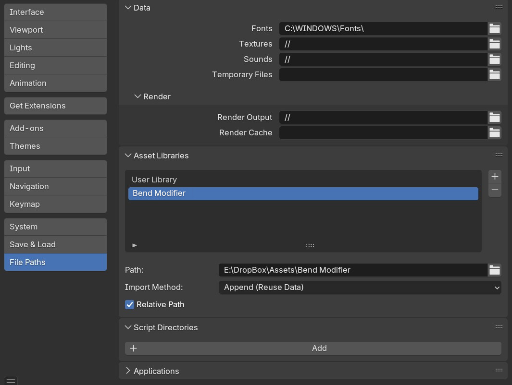

.. _installation:

#############
Installation
#############

The *Bend Modifier* is a **Modifier asset**, meaning it is installed as part of Blender’s **Asset Library** rather than a traditional add-on. Once set up, you should be able to access it directly from the **Deform** category in Blender’s modifier menu.

Step 1: Download the Files
--------------------------------

#. You will be provided with the following files:

    * ``bend_modifier.blend``: This is the main file containing the modifier asset.

    * ``blender_assets.cats.txt``: This is the configuration file that tells Blender to add the modifier to the "Deform" modifier category.

#. Save these files together to a new folder where you want to store your **Blender Asset Library**.

Step 2: Set Up Your Asset Library in Blender
--------------------------------------------

*Asset Libraries under File Paths, as in Blender 5.1 and earlier. In Blender 5.2 and later, it has its own tab.*

If you haven’t already set up an **Asset Library**, follow these steps:

#. Open **Blender** and go to **Edit → Preferences**.
#. Open the Asset Libraries settings. Where they are depends on your Blender version:

   * **Blender 5.2 and later:** click the **Asset Libraries** tab.
   * **Blender 4.5 to 5.1:** click the **File Paths** tab and find the **Asset Libraries** panel.

#. Click the **+** (*Add New*) button.
#. Name the library (e.g., “My Assets”) and select the folder where you saved the *Bend Modifier* ``.blend`` file.
#. Click **Save Preferences**.

.. note::

   Add the folder under **Asset Libraries**, not **Script Directories**. The *Bend Modifier* is an asset rather than an add-on, so it won't appear in Blender if it is added as a script directory.

You can then follow the steps in :ref:`How to Use<quick_start>`.

.. _add_cat:

.. note::

   **Ensuring Bend Modifier Appears in the Deform Modifier Category**

   By default, Blender **does not categorize custom modifier assets automatically**.

   If *Bend Modifier* appears in the **Unassigned** category instead of **Deform**, follow these steps to manually set the correct category inside Blender.

   #. Once downloaded to the directory you wish to keep the asset, open the bend_modifier.blend file.

      .. image:: _static/images/add_cat.jpg
         :alt: Bend Modifier

   #. In the Asset Browser window, click the '+' button to create a new asset catalog.  A new catalog will appear:

      .. image:: _static/images/add_cat2.jpg
         :alt: New Catalog

   #. Double click the new catalog to rename it.  Name it 'Deform':

      .. image:: _static/images/add_cat3.jpg
         :alt: Rename Catalog

   #. Drag the Bend Modifier from the 'Unassigned' category to the 'Deform' category:

      .. image:: _static/images/add_cat4.jpg
         :alt: Drag and Drop

   #. Save the .blend file and restart Blender to refresh the Asset Library.

